# 한국 공교육 IB 도입 현황 (2026년 기준)

> **2026.10 업데이트:** IB 수업·프로젝트 방식(2-6), 논·서술형에 강한 이유(2-7), 사고관의 전환(2-8), IB vs KB(2-9), 초·중·고 대표 IB 학교와 IB 벨트(3-0), 학교 선택 시 IB 연차의 중요성(3-0-1), 경기외고 고성적 요인 분석(3-2), 표선고 케이스 스터디(3-4) 추가

## 먼저 알아야 할 핵심 용어

> IB 관련 문서를 읽기 전에 아래 용어를 먼저 이해하면 전체 흐름이 쉽게 잡힙니다.

### IB 기본 용어

| 용어 | 뜻 | 쉽게 말하면 |
|------|-----|-----------|
| **IB** (International Baccalaureate) | 국제 바칼로레아. 스위스 IBO가 운영하는 국제 교육 프로그램 | 전 세계 공통 교육과정 (한국 교육과정과 별개) |
| **IBO** (IB Organization) | IB를 만들고 관리하는 스위스 본부 기관 | IB의 "교육부" 역할 |
| **IB 월드스쿨** (IB World School) | IBO로부터 최종 인증을 받은 학교 | "IB 정식 운영 학교" = 인증학교 |

### IB 프로그램 종류 (학교급별)

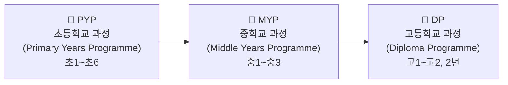

| 약어 | 정식 명칭 | 대상 | 핵심 |
|------|----------|------|------|
| **PYP** | Primary Years Programme | 초등학교 (3~12세) | 탐구 중심 학습, 주제 통합 수업 |
| **MYP** | Middle Years Programme | 중학교 (11~16세) | 교과 간 연결, 개념 기반 학습 |
| **DP** | Diploma Programme | 고등학교 (16~19세, 2년) | 6과목 + TOK/EE/CAS, 최대 45점, **국제 공인 학력** |

> **"DP 인증학교"** = IBO로부터 고등학교 과정(DP)을 정식 운영할 수 있다고 인증받은 학교.
> 같은 학교라도 PYP만 인증받고 MYP/DP는 아직인 경우가 있으므로, **어떤 프로그램의 인증인지**가 중요합니다.

### IB 학교 인증 단계 (3단계)

학교가 IB를 도입하려면 IBO의 심사를 거쳐 단계별로 승격됩니다.

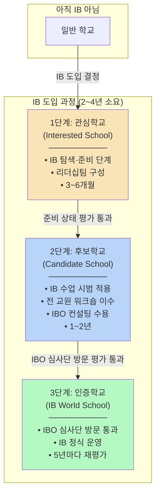

| 단계 | 한국어 | 영어 | 의미 | IB 수업 가능? |
|------|--------|------|------|:------------:|
| **1단계** | 관심학교 | Interested School | IB를 알아보고 준비하는 중 | ❌ 불가 |
| **2단계** | 후보학교 | Candidate School | IB 수업을 시범 적용하며 인증 준비 중 | ⚠️ 시범만 가능 |
| **3단계** | 인증학교 (= 월드스쿨) | Authorized School (= IB World School) | IBO가 공식 인증한 정식 IB 학교 | ✅ 정식 운영 |

> **핵심 포인트:** "IB 학교"라고 해서 모두 같은 수준이 아닙니다.
> - **관심학교 106교** ≠ IB 수업을 하는 학교 106교
> - **인증학교(월드스쿨)만** IB 디플로마를 발급할 수 있는 정식 IB 학교입니다
> - 뉴스에서 "IB 학교 225교"라고 하면 관심+후보+인증을 모두 합친 숫자입니다

### DP 수업에서 나오는 용어

| 용어 | 뜻 | 쉽게 말하면 |
|------|-----|-----------|
| **HL** (Higher Level) | 심화 수준 과목 (240시간) | 깊이 배우는 과목 (3~4과목 선택) |
| **SL** (Standard Level) | 표준 수준 과목 (150시간) | 기본 수준으로 배우는 과목 |
| **TOK** (Theory of Knowledge) | 지식이론 — 지식의 본질을 탐구 | "우리가 아는 것을 어떻게 아는가?" 철학 수업 |
| **EE** (Extended Essay) | 확장 에세이 — 4,000단어 연구 논문 | 대학 졸업논문의 고등학생 버전 |
| **CAS** (Creativity, Activity, Service) | 창의·활동·봉사 프로젝트 | 18개월간 봉사+운동+창작 활동 필수 |
| **IA** (Internal Assessment) | 내부평가 — 교사가 채점, IBO가 검증 | 실험보고서, 구술발표, 연구과제 등 |
| **EA** (External Assessment) | 외부평가 — IBO 본부가 출제·채점 | IB 최종 시험 (논술형) |
| **IB 디플로마** | IB DP 과정 수료 증서 | 총 24점 이상 + 모든 조건 충족 시 발급되는 국제 공인 학력 |

---

## 전체 현황 요약

| 항목 | 수치 | 설명 |
|------|------|------|
| 시도교육청 도입 | **17개** | 전국 17개 시도교육청 모두 IB 도입 완료 |
| 전국 IB 학교 | **360교 이상** | 관심·후보·인증 단계 포함 |
| IB 월드스쿨 (인증) | **118교** | 전국 인증 완료 학교 (2026년 기준) |
| 공교육 DP 인증 고등학교 | **약 18~20교** | 국제학교 제외, 공교육 고등학교 기준 |

---

## 1. IB 인증 3단계

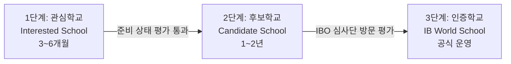

| 단계 | 명칭 | 소요 기간 | 주요 요건 |
|------|------|----------|----------|
| **1단계** | 관심학교 (Interested School) | 3~6개월 | IB 프로그램 탐색, IB 리더십팀 조직, 전문적 학습공동체 운영, IB 평가자의 준비 상태 평가 통과 |
| **2단계** | 후보학교 (Candidate School) | 최소 1년~최대 2년 | IB 수업·평가 적용, 전 교원 IB 워크숍 참여, IBO 컨설턴트 대면·비대면 컨설팅 수용, 학습 운영 과제 실천 |
| **3단계** | 인증학교 (Authorized School / World School) | 심사단 방문 평가 후 | IB 프로그램 전면 도입·운영, IBO 심사단 방문 평가 통과, 공식 IB 월드스쿨 자격 획득 |

> 관심학교부터 인증학교까지 전체 과정은 약 **2~4년** 소요

---

## 2. IB DP(고등학교 과정) 수업 방식

### 2-1. 과목 구성: 6개 과목군 + 3개 핵심 과정

| 과목군 | 영역 | 과목 예시 |
|--------|------|----------|
| Group 1 | 언어와 문학 (Studies in Language & Literature) | 한국어 A, 영어 A |
| Group 2 | 언어 습득 (Language Acquisition) | 영어 B, 중국어, 일본어 |
| Group 3 | 개인과 사회 (Individuals & Societies) | 경제학, 역사, 경영학, 심리학 |
| Group 4 | 과학 (Sciences) | 물리학, 화학, 생물학, 컴퓨터과학 |
| Group 5 | 수학 (Mathematics) | 수학 AA(분석과 접근), 수학 AI(응용과 해석) |
| Group 6 | 예술 (The Arts) | 미술, 음악, 연극 (또는 Group 1~4에서 추가 선택 가능) |

- 6과목 중 **3~4과목은 HL(Higher Level, 240시간)**, 나머지는 **SL(Standard Level, 150시간)**
- 각 과목 **최대 7점**, 6과목 합산 **최대 42점**

### 2-2. 핵심 과정 (Core Components)

| 핵심 과정 | 내용 | 평가 방식 | 배점 |
|----------|------|----------|------|
| **TOK** (Theory of Knowledge, 지식이론) | 지식의 본질과 인식 방법을 탐구하는 철학적 수업 (100시간) | 에세이 1편 + 전시회(Exhibition) | 최대 3점 (EE와 합산) |
| **EE** (Extended Essay, 확장에세이) | 학생이 선택한 주제로 독립 연구, 4,000단어 논문 작성 | 외부 평가(IBO 채점) | TOK와 합산하여 최대 3점 |
| **CAS** (Creativity, Activity, Service) | 창의성·신체활동·봉사 프로젝트 수행 (18개월간) | 이수/미이수 (미이수 시 디플로마 불가) | - |

**총점: 과목 42점 + 핵심 3점 = 최대 45점**

### 2-3. 디플로마 미수여 조건 (Failing Conditions)

다음 중 하나라도 해당하면 IB 디플로마가 수여되지 않습니다:

| 조건 | 설명 |
|------|------|
| 총점 24점 미만 | 6과목 + 보너스 합산 24점 이상 필요 |
| 과목 1점 | 어떤 과목이든 1점을 받으면 불가 |
| 3과목 이상 3점 이하 | HL/SL 무관 |
| CAS 미완료 | 18개월간 창의·활동·봉사 포트폴리오 필수 |
| TOK 또는 EE에서 E등급 | 최저 등급 시 불가 |
| 표절 적발 | 학문적 정직성 위반 시 불가 |

### 2-4. 평가 방식

| 구분 | 내용 | 비율 |
|------|------|------|
| **외부평가 (EA)** | IBO 본부 출제·채점, 5월 시행, 과목당 2~3개 시험지, 서술형·분석형 중심 | 약 70~80% |
| **내부평가 (IA)** | 교사 평가 → IBO 조정. 과학: 실험보고서, 수학: 수학적 탐구, 영어: 구술발표, 경제: 기사분석 | 약 20~30% (예술 35~50%) |

### 2-5. 한국 일반고 vs IB DP 수업 비교

| 비교 항목 | 한국 일반고 | IB DP |
|----------|-----------|-------|
| **수업 방식** | 강의 중심, 교과서 기반 | 토론·탐구·프로젝트 중심 |
| **평가 방식** | 객관식+단답형, 상대평가(내신 등급) | 논술형·서술형, 절대평가(1~7점) |
| **교육과정** | 3년 (고1~고3) | 2년 (pre-DP 1년 + DP 2년) |
| **시험 출제** | 학교 자체 출제 | IBO 본부 출제 (외부평가) |
| **성적 인증** | 국내 내신 등급 | IB 디플로마 (국제 공인 학력) |
| **핵심 역량** | 교과 지식 암기·적용 | 비판적 사고, 연구 능력, 자기주도 학습 |

### 2-6. IB 수업은 실제로 어떻게 진행되나 — 탐구·프로젝트 수업의 실제

> IB 수업의 단위는 "진도"가 아니라 **"탐구 단원(Unit of Inquiry)"** 입니다. 한 단원은 보통 3~6주이며, 교사가 설명하고 학생이 받아 적는 시간보다 **학생이 질문하고, 조사하고, 쓰고, 말하고, 고치는 시간**이 훨씬 깁니다.

#### (1) 한 단원이 굴러가는 6단계 사이클

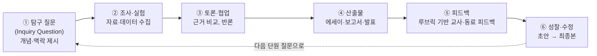

| 단계 | 교실에서 실제로 하는 일 | 교사의 역할 |
|------|----------------------|-----------|
| ① 탐구 질문 | "기후 위기 책임은 누구에게 더 있는가?"처럼 **정답이 하나가 아닌 질문**으로 시작 | 핵심 개념(Key Concept)·글로벌 맥락 제시 |
| ② 조사·실험 | 1차·2차 자료, 통계, 실험 데이터 수집 | 자료 신뢰도 판단법 코칭 |
| ③ 토론·협업 | 조별로 근거를 비교하고 **반론을 스스로 세움** | 질문으로 사고를 밀어붙이는 퍼실리테이터 |
| ④ 산출물 | 에세이, 실험보고서, 구술 발표, 포스터, 전시 | 평가 기준(Criteria) 사전 공개 |
| ⑤ 피드백 | 루브릭 항목별 피드백 (점수보다 코멘트 중심) | 1:1 컨퍼런스 |
| ⑥ 성찰·수정 | 성찰 일지 작성, 초안 수정 후 최종 제출 | 과정 기록 검토 (학문적 정직성 확인) |

#### (2) IB 수업 6대 교수 원칙 (ATT, Approaches to Teaching)

| 원칙 | 의미 | 교실 장면 예시 |
|------|------|-------------|
| 탐구 기반 | 질문에서 출발 | 교사가 공식을 주기 전에 학생이 데이터에서 규칙을 먼저 찾음 |
| 개념 이해 중심 | 사실보다 개념 | "변화", "관계", "체계" 같은 개념으로 과목을 연결 |
| 지역·세계 맥락 | 내 동네 → 세계 | 제주 해양쓰레기 → SDG 14로 확장 |
| 협업 | 팀 단위 탐구 | 조별 실험 설계, 동료 평가 |
| 개별화 | 학생마다 다른 도달 경로 | 같은 IA라도 주제는 학생마다 다름 |
| 평가 정보 활용 | 평가가 곧 학습 | 형성평가 결과로 다음 수업 조정 |

#### (3) 실제 수업 사례 (국내 공교육 IB)

| 학교 | 과목 | 수업 장면 |
|------|------|---------|
| 경북대사대부고 | **TOK** | 여러 종류의 지도(메르카토르 도법, 시대별 지도 등)를 비교 → "왜 지도마다 다를까?" → 정확성의 한계, 시대 권력이 지식에 반영되는 방식을 토론 |
| 경북대사대부고 | **수학** | 미적분 개념을 바탕으로 조별로 **'미적분 밈(meme)'을 제작·발표** → 다른 조 밈의 개념 오류를 서로 평가 |
| 표선고 | **EE·CAS** | 표선면 지역사회·공동체를 소재로 한 봉사·탐구 프로젝트를 소논문(EE)·1개월 이상 협업 프로젝트(CAS)로 연결 |
| 대구중앙고 | 전 과목 | 모든 평가가 서술·구술 → "답을 외운 학생"이 아니라 "근거를 대는 학생"이 점수를 받는 구조 |

#### (4) IB 프로그램별 대표 프로젝트

| 학교급 | 프로젝트 | 분량·기간 | 핵심 |
|------|---------|---------|------|
| 초 (PYP) | **PYP Exhibition** | 6학년, 약 6~8주 | 실생활 문제를 정해 조별 탐구 → 학부모·지역 대상 전시 발표 |
| 중 (MYP) | **Personal Project** | 중3(MYP 5년차), 약 6~9개월 | 개인 관심 주제로 결과물(제품·캠페인·작품 등) 제작 + 보고서 |
| 중 (MYP) | **Interdisciplinary Unit** | 학년별 1회 이상 | 두 과목 이상을 묶는 융합 단원 (예: 과학 + 사회 "에너지 정책") |
| 고 (DP) | **IA (내부평가)** | 과목당 1개, 수주~수개월 | 과학 실험 설계·보고서, 수학 탐구(Exploration), 경제 기사 분석, 언어 구술 |
| 고 (DP) | **EE (확장 에세이)** | 4,000단어(한국어 DP는 한국어 기준), 약 12~18개월 | 독립 연구 논문, 지도교사 정기 면담 + 성찰 기록 3회 |
| 고 (DP) | **TOK 전시 + 에세이** | 전시(DP1) + 1,600단어 에세이(DP2) | 지식이 만들어지는 방식을 사물 3개로 전시·논증 |
| 고 (DP) | **CAS 프로젝트** | 18개월, 1개월 이상 협업 프로젝트 1개 필수 | 창의·활동·봉사 + 성찰 포트폴리오 |

#### (5) DP 2년 프로젝트 캘린더 (일반적 흐름)

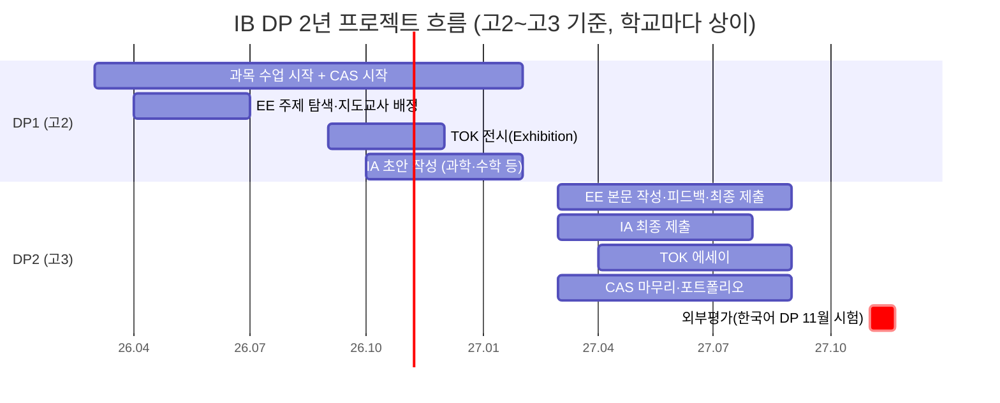

> 한국어 DP는 국내 학사일정에 맞춰 **11월에 외부평가**를 치르며, 결과는 이듬해 1월 초에 발표됩니다. 수시 원서(9월)를 쓸 때는 IB 점수가 아직 없으므로, 국내 수시는 **학생부(내신·세특)** 로 지원합니다.

### 2-7. 왜 IB 학생은 논·서술형에 강한가

IB DP의 모든 평가는 **객관식 0%**입니다. 2년 동안 학생이 쓰는 글의 총량이 일반고와 비교가 되지 않습니다.

| 항목 | 일반고 (3년) | IB DP (2년) |
|------|-----------|-----------|
| 장문 글쓰기 (1,000자+) | 수행평가 일부 | IA 6편 + EE 1편 + TOK 에세이 1편 + 과목별 에세이 수십 편 |
| 최장 글 | 보통 2,000~3,000자 내외 | **EE 4,000단어 (한국어 약 1만 자 이상)** |
| 구술 평가 | 거의 없음 | 언어 과목 구술, TOK 발표, EE 최종 면담(viva) |
| 초안 → 피드백 → 수정 | 드묾 | **모든 IA·EE에 의무적으로 내장** |
| 채점 기준 공개 | 학교마다 다름 | **루브릭(Criteria)을 사전 공개** — 학생이 기준을 보고 씀 |

**IB 학생이 논·서술형에 강해지는 5가지 메커니즘**

| # | 메커니즘 | 설명 |
|---|---------|------|
| 1 | **루브릭 내면화** | 매번 "주장–근거–분석–평가–결론" 기준표로 채점받다 보니, 시험장에서도 채점자의 눈으로 자기 답안을 설계 |
| 2 | **명령어(Command Term) 훈련** | IB는 "설명하라(explain)", "평가하라(evaluate)", "논하라(discuss)", "비교하라(compare)"의 요구 수준을 구분해 가르침 → 문제가 무엇을 요구하는지 정확히 읽음 |
| 3 | **반론 의무화** | TOK·EE·역사·경제 에세이 모두 반대 관점(counterclaim)을 다루지 않으면 상위 점수가 불가 |
| 4 | **분량 체력** | 4,000단어 논문을 1년 넘게 다듬은 학생에게 1,000자 서술형은 부담이 아님 |
| 5 | **과정 증빙** | 초안·성찰 기록·구술 면담으로 "내가 쓴 글"임을 증명 → AI 대필이 통하지 않는 구조라 실제 쓰기 능력이 길러짐 |

> **2028 이후 의미:** 2028 대입 개편으로 고교 내신 서·논술형 평가가 확대되고, 대구 KB 등 교육청 차원의 논·서술형 평가가 시작되고 있습니다. IB 학생은 이 변화의 **"이미 2년을 미리 훈련한 집단"** 입니다.

### 2-8. 사고관의 전환 — "정답 찾기"에서 "프로세스 설계"로

IB를 2년 이상 경험한 학생에게서 공통으로 관찰되는 변화는 성적보다 **사고 방식**입니다.

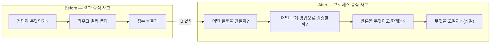

| 구분 | 결과 중심 (기존) | 프로세스 중심 (IB 이후) |
|------|---------------|---------------------|
| 출발점 | 주어진 문제 | **내가 만든 탐구 질문** |
| 성공 기준 | 정답 맞히기 | 근거의 질, 방법의 타당성, 한계 인식 |
| 실패의 의미 | 감점 | **다음 초안의 재료** (피드백 → 수정) |
| 시간 관리 | 시험 직전 몰아치기 | 12~18개월 장기 프로젝트 역산 계획 |
| AI 활용 | 답을 받아 적음 | 자료 조사·반론 점검용으로 쓰고, 논증은 직접 |
| 생기부에 남는 것 | "~를 이해함" | "~라는 질문을 세우고, ~ 방법으로 검증하고, ~ 한계를 발견해 수정함" |

> **입학사정관 관점:** 학종 서류에서 IB 학생의 세특이 강한 이유는 결과가 아니라 **"질문 → 방법 → 한계 → 수정"의 프로세스가 문장으로 남기 때문**입니다. 면접에서도 "왜 그 방법을 택했나?", "한계는?"이라는 질문에 자기 언어로 답할 수 있습니다.

### 2-9. IB vs KB — 한눈에 비교

> 상세 비교는 [(IB vs KB)-중학생_길라잡이_입학사정관_비교가이드.md](./(IB%20vs%20KB)-중학생_길라잡이_입학사정관_비교가이드.md) 참고

| 비교 항목 | **IB** (국제 바칼로레아) | **KB** (한국형 바칼로레아) |
|---|---|---|
| 운영 주체 | IBO (스위스) | 교육부 + 시도교육청 (대구 선도) |
| 교육과정 | IB 자체 교육과정 | **국가 교육과정 유지 + 평가 방식만 전환** |
| 평가 | 서술형 100% (IA + EA), IBO 채점 | 논·서·구술형 중심, 한국 교사 채점 + 교육청 검증 |
| 핵심 과정 | TOK · EE · CAS | K-Think · K-Essay · K-Act (개발 중) |
| 언어 | 영어 / 한국어 DP | 한국어 100% |
| 비용 | 공립 무상(교육청이 IBO 비용 부담), 국제학교 연 3,000만원+ | 무상 |
| 국제 인정 | 전 세계 대학 인정, IB 점수로 해외대 직접 지원 | 국내 한정 |
| 현재 상태 | **실제 운영 중**, 졸업생·대입 실적 존재 | 2026년 9월 대구에서 평가 시스템 첫 가동 — 대입 공식 인정 전 |
| 누가 유리한가 | 지금 중학생 중 해외대·학종 지향, 글쓰기 체력 있는 학생 | 일반고 진학생 전체 (평가 방식 변화로 간접 영향) |

**공통점 — 왜 같이 봐야 하나:** 둘 다 "정답 암기"에서 **"근거를 세우는 글쓰기와 과정 평가"** 로 간다는 방향이 같습니다. KB는 IB의 수업·평가 철학을 국가 교육과정 안으로 옮기려는 시도이므로, **IB 학교의 경험(특히 연차가 쌓인 학교의 코칭 노하우)이 KB의 원형**이 됩니다.

---

## 3. 지역별 IB DP 고등학교 상세 현황

### 3-0. 학교급별 국내 대표 IB 학교 (초·중·고)

> IB는 고등학교(DP)만 있는 것이 아닙니다. 초(PYP) → 중(MYP) → 고(DP)가 **한 지역 안에서 이어지는 "IB 벨트"** 가 있는 곳은 고교 입학 후 적응 기간이 크게 줄어듭니다.

#### 초등학교 (PYP) 대표 학교

| 지역 | 학교 | 특징 |
|------|------|------|
| 서울 | **서울구로초** | 2025.11 PYP 인증 — **서울시교육청 1호 IB 월드스쿨** |
| 서울 | 서울대왕초 | 서울 공립 초 PYP 인증 (2025.12 무렵, 구로초와 함께 서울 초기 인증교) |
| 대구 | 대구초 | 120년 역사 학교, 2024.8 대구 11번째 PYP 월드스쿨 |
| 대구 | 대구테크노초 | 전국 공립 최초 **유치원–초 연계 PYP** |
| 대구 | 대구교대 안동부설초 | PYP 월드스쿨 승인 |
| 제주 | **표선초 · 토산초 · 온평초 · 풍천초** | 표선·성산 권역 PYP — 표선중·표선고와 IB 지구 형성 |
| 제주 | 제주북초 | 제주시 동(洞)지역 첫 PYP 월드스쿨 |
| 경기 | 개산초 (안성) | 개산초–죽산중–죽산고 연계 IB 벨트의 출발점 |

#### 중학교 (MYP) 대표 학교

| 지역 | 학교 | 특징 |
|------|------|------|
| 제주 | **표선중** | 제주 유일 MYP 인증 중학교 → 표선고 DP로 연결 |
| 대구 | **대구중앙중** | 국내 **사립 중학교 최초** MYP 월드스쿨 → 대구중앙고 DP 연계 |
| 대구 | 경북대사대부중 | 경북대 사대부설 초·중·고 축의 중학교 트랙 |
| 경기 | 죽산중 (안성) | 죽산고와 중·고 통합 운영, MYP 인증 |
| 경기 | 내손중 (의왕) | 내손중(MYP) → 내손고(DP 후보) 경기형 지역 벨트 |
| 전남 | 나주금천중 | **광주·전남 최초** MYP 월드스쿨 |
| 경기 | 군서미래국제학교 (시흥) | 한 캠퍼스에서 PYP·MYP·DP 전 과정 |

> 대구는 2026년 기준 초등 10여 곳, 중등 11곳, 고등 5~6곳의 월드스쿨을 운영해 **전국에서 가장 촘촘한 IB 벨트**를 갖고 있습니다.

#### 고등학교 (DP) 대표 학교 — 유형별

| 유형 | 대표 학교 | 수업 언어 | 비용 | 입학 방식 |
|------|---------|---------|------|---------|
| 공립 일반고 (전교생 이수) | **표선고**, 포산고, 대구서부고, 죽산고 | 한국어 DP | 무상 | 일반 고입 (표선고는 내신 100%) |
| 국립 사대부고 | 경북대사대부고 | 한국어+영어 | 무상 | 일반 고입 + 교내 DP 선택 |
| 특목고 (외고·국제고) | **경기외고**, 대구외고, 대구국제고, 동탄국제고 | 영어 / 한국어 | 수업료 있음 | 특목고 자기주도학습전형 + 교내 IB반 선발 |
| 자사고 | 충남삼성고 | 영어 | 수업료 있음 | 자사고 전형 |
| 대안학교 | 지평선고, 중앙기독고 | 한국어 / 영어 | 학교별 상이 | 학교 자체 전형 |
| 국제학교 | 채드윅송도, 브랭섬홀아시아, NLCS 제주, SFS, 드와이트, 덜위치 | 영어 | 연 3,000~5,000만원 | 학교 자체 전형 |

#### IB 벨트 (초 → 중 → 고 연결) 대표 지역

| 지역 | PYP (초) | MYP (중) | DP (고) |
|------|---------|---------|--------|
| 제주 표선 | 표선초·토산초·온평초·풍천초 | 표선중 | **표선고** |
| 경기 안성 죽산 | 개산초 | 죽산중 | 죽산고 |
| 대구 수성 | — | 대구중앙중 | 대구중앙고 |
| 대구 (국립) | 경북대사대부초 | 경북대사대부중 | 경북대사대부고 |
| 경기 시흥 | 군서미래국제학교 (통합) | ← | ← |

### 3-0-1. 학교를 고를 때 "IB 연차"를 반드시 봐야 하는 이유

> **IB는 인증을 받았다고 바로 완성되는 교육이 아닙니다.** 프로젝트형 교육은 **졸업생을 배출할 때마다 교사의 코칭 노하우가 누적**되기 때문에, 연차가 쌓인 학교일수록 IA·EE·TOK 지도의 질이 확연히 높아집니다.

**연차가 쌓이면 무엇이 쌓이나**

| 누적 자산 | 1~2기 학교 | 5기 이상 학교 |
|----------|----------|------------|
| **IA·EE 모범 사례 아카이브** | 없음 — 교사도 처음 지도 | 점수대별 실제 학생 산출물 보유 → "이 정도 쓰면 몇 점" 감각 |
| **IBO 채점 조정(Moderation) 피드백** | 1~2회 | 매년 IBO가 교사 채점을 조정한 데이터 누적 → 교내 채점이 IBO 기준과 일치 |
| **교사의 IB 채점관(Examiner) 경험** | 드묾 | IBO 채점관 활동 교사 → 채점 기준을 "안에서" 이해 |
| **EE 지도 체계** | 지도교사 1인 역량에 의존 | 주제 선정 → 면담 → 초안 피드백 일정이 표준화 |
| **국내 대입 노하우** | IB 활동을 세특으로 옮기는 방법 탐색 중 | 대학이 읽기 좋은 세특 문장·전형 매칭 경험 축적 |
| **대학의 학교 인지도** | 대학 입학사정관이 학교 교육과정을 잘 모름 | 입학사정관이 학교 프로파일·IB 과정을 이미 이해 |
| **선배 네트워크** | 없음 | 선배의 EE 주제·대입 경로·해외대 지원 경험 공유 |

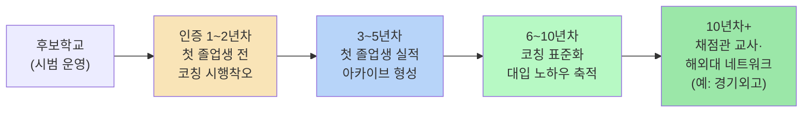

**국내 공교육 DP 고교 연차표 (2026년 기준)**

| 연차 그룹 | 학교 (DP 인증 시점) | 졸업생 배출 | 상담 포인트 |
|----------|-----------------|----------|-----------|
| **10년차+** | 경기외고 (2011 도입) | 10기 이상 | 코칭·해외대 노하우 국내 최고 |
| **4~6년차** | 충남삼성고 (2020), 경북대사대부고·포산고 (2021.9), 표선고 (2021.11), 대구외고·대구국제고·대구서부고 | 1~4기 | 실적 데이터가 공개되기 시작한 단계 — **가장 현실적인 공교육 선택지** |
| **1~2년차** | 죽산고 (2025.1), 동탄국제고·남양주다산고·덕정고·관양고 (2025.11), 대구중앙고·단재고 (2025.12), 지평선고 (2026.6) | 없음 | 실적 없음 — "계획서"로 판단해야 함, 첫 기수의 장점(교사 관심 집중)과 위험(시행착오) 공존 |
| **후보학교** | 대전대성고·서대전고·서일고, 내손고, 수성고, 포천고, 풍산고, 전북 후보 6교 등 | 없음 | 아직 디플로마 미발급 — **내 입학 연도에 DP가 정식 개설되는지** 반드시 확인 |

**설명회에서 반드시 물어볼 질문 7가지**

1. 우리 학교 DP 졸업생은 몇 기까지 나왔고, 기수별 **응시 인원·디플로마 취득률·평균 점수**는?
2. IB 공인 워크숍을 이수한 교사는 몇 명이고, **IBO 채점관 경험 교사**가 있는가?
3. EE 지도교사 1명당 학생 수와 **면담 횟수**는?
4. IA·EE **과거 산출물 아카이브**를 학생이 열람할 수 있는가?
5. IB 졸업생은 국내 대학에 **어떤 전형(학종·교과·논술)** 으로 진학했는가?
6. 개설된 HL/SL 과목 조합은? (원하는 진로의 HL이 없을 수 있음)
7. IB 외부평가 응시료는 누가 부담하는가?

### 3-1. 대구광역시 — DP 인증학교 6교 (전국 선도)

> 2019년 전국 최초 공교육 IB 도입. 총 114교 운영 (기초 33, 관심 22, 후보 26, 인증 32)
> 대구는 초(PYP)→중(MYP)→고(DP) IB 벨트를 전국 최초로 완성

---

#### 경북대학교사범대학부설고등학교 (경북대사대부고)

| 항목 | 내용 |
|------|------|
| **홈페이지** | [knue.dge.hs.kr](https://knue.dge.hs.kr) |
| **위치** | 대구광역시 북구 |
| **인증** | 인증학교 (2021.09) — **전국 공교육 최초 IB DP 월드스쿨** |
| **학교 유형** | 국립 부설 고등학교 |

**학교 특징:**
- 전국 공교육 최초로 IB DP 월드스쿨 인증을 받은 상징적 학교
- 경북대학교 사범대학과 연계한 교원 전문성 확보
- 1기 졸업생 30명 전원 디플로마 또는 과목 이수증 취득
- 38점 이상 고득점자 5명 배출 (해외 명문대 진학 가능 수준)

**대입 실적:**

| 구분 | 1기 졸업생 (2024 대입) | 2기 졸업생 (2025 대입) |
|------|----------------------|----------------------|
| 디플로마 취득 | 30명 전원 (디플로마+과목이수증) | 18명 디플로마 + 11명 과목이수증 |
| 평균 점수 | - | 30.9점 (세계 평균 29점 상회) |
| 고득점자 | 38점 이상 5명 | 37점 이상 4명 |
| 주요 합격 대학 | 연세대, 고려대, 성균관대, DGIST, UNIST, KENTECH — 수도권 주요 대학 22명 합격 | 연세대, 서울시립대, 경북대, DGIST 등 |

---

#### 포산고등학교

| 항목 | 내용 |
|------|------|
| **홈페이지** | [posan.dge.hs.kr](https://posan.dge.hs.kr) |
| **위치** | 대구광역시 달성군 |
| **인증** | 인증학교 (2021.09) — 경북대사대부고와 동시 인증 |
| **학교 유형** | 공립 일반고 |

**학교 특징:**
- 달성군 IB 교육의 거점 학교
- 농촌 지역 공립 일반고에서 IB 도입 성공 사례로 주목
- 2기 졸업생 21명 중 15명 풀 디플로마 취득

**대입 실적:**

| 구분 | 내용 |
|------|------|
| 2기 졸업생 | 21명 중 20명 국내외 대학 합격 |
| 최고 점수 | 39점 (캐나다 University of Alberta 합격) |
| 주요 합격 대학 | 건국대, 명지대, 대구교대, 광주교대 등 — 이공계·인문계·예술 다양 |

---

#### 대구외국어고등학교

| 항목 | 내용 |
|------|------|
| **홈페이지** | [dgfl.dge.hs.kr](https://dgfl.dge.hs.kr) |
| **위치** | 대구광역시 달서구 |
| **인증** | 인증학교 — **전국 국·공립 최초 한국어 IB DP 월드스쿨** |
| **학교 유형** | 공립 특수목적고 (외국어고) |

**학교 특징:**
- 1997년 개교한 외국어고등학교로서 외국어 교육 강점
- 2기 졸업생 응시생 **100% 전체 디플로마 취득** (전국 최고 성적)
- 평균 점수 30.5점, 33점 이상 학생 40%
- 개별 맞춤형 학습 코칭, 체계적 글쓰기 교육이 강점

**대입 실적:**

| 구분 | 내용 |
|------|------|
| 3년간 졸업생 총 54명 | 서울 주요 상위권 대학 대거 합격 |
| 주요 합격 대학 | 연세대, 고려대, 서강대, 성균관대, 이화여대, 지방 거점 국립대 |
| 주요 진학 전공 | 국제학부, 글로벌경제학과, 정치외교학과, 영어영문학과 등 어문·국제 계열 |

---

#### 대구국제고등학교

| 항목 | 내용 |
|------|------|
| **홈페이지** | [dhi.dge.hs.kr](https://dhi.dge.hs.kr) |
| **위치** | 대구광역시 |
| **인증** | 인증학교 |
| **학교 유형** | 대구시교육청 소속 국제고등학교 |

**학교 특징:**
- 첫 졸업생 20명 중 19명 디플로마 취득 — **취득률 95%** (세계 평균 73.8% 대비 압도)
- 평균 점수 31점 (세계 평균 29점 상회)
- 이중언어 디플로마(Bilingual Diploma) 18명(90%) 취득 — 경제 등을 영어로 이수

**대입 실적:**

| 구분 | 내용 |
|------|------|
| 국내 대학 | 연세대, 성균관대, 한양대, 중앙대, 건국대, 서울시립대, 숙명여대 등 — 글로벌학부, 경제경영학부 |
| 해외 대학 | 호주 멜버른대, 모나쉬대, 미국 엠브리-리들 항공대, 홍콩대 등 |

---

#### 대구서부고등학교

| 항목 | 내용 |
|------|------|
| **홈페이지** | [dgseobu.dge.hs.kr](https://dgseobu.dge.hs.kr) |
| **위치** | 대구광역시 서구 |
| **인증** | 인증학교 — 대구 5번째 DP 월드스쿨 |
| **학교 유형** | 공립 일반고 |

**학교 특징:**
- 대구외고, 포산고와 함께 DP 거점 고등학교로서 IB 벨트 형성
- 일반고에서 IB를 성공적으로 운영하는 모델
- IB DP 대학 진학률: 1기 81.8%, 2기 85% (전국 고교 평균 73.6% 상회)

**대입 실적:**
- 주로 수능 최저등급 없는 학생부종합전형, 논술전형으로 진학
- 캐나다·영국·호주 등 해외 대학, 수도권 주요 대학, 지방 거점 대학, DGIST 등 연구 중심 대학에 다수 합격

---

#### 대구중앙고등학교

| 항목 | 내용 |
|------|------|
| **홈페이지** | [djoongang.dge.hs.kr](https://djoongang.dge.hs.kr) |
| **위치** | 대구광역시 |
| **인증** | 인증학교 (2025.12) — **대구 사립고 최초 IB DP 인증** |
| **학교 유형** | 사립 일반고 |

**학교 특징:**
- 전국 일반계 사립 최초로 MYP + DP 연속 운영 IB 월드스쿨
- 2021년 관심학교 → 2023년 후보학교 → 2025년 인증학교 (4년 과정)
- 개념 기반 탐구 학습, 학생 주도 수업 문화 정착
- 지역사회 연계 프로젝트·협업 기회 풍부

**대입 실적:**
- 2025.12 인증으로 아직 DP 졸업생 미배출 (첫 졸업생 2027~2028년 예상)

---

### 3-2. 경기도 — DP 인증학교 8교 (전국 최대 규모 확산)

> 총 297교 운영 (관심 244, 후보 42, 인증 21)

---

#### 경기외국어고등학교

| 항목 | 내용 |
|------|------|
| **홈페이지** | [gafl.hs.kr](https://gafl.hs.kr) |
| **위치** | 경기도 의왕시 |
| **인증** | 인증학교 (2011) — **국내 최초 IB DP 도입** (영어 운영) |
| **학교 유형** | 사립 특수목적고 (외국어고), 전원 기숙 |

**학교 특징:**
- 2011년 국내 고등학교 최초로 IB DP 도입한 원조 IB 학교
- IB 국제반과 국내반을 **이원화 운영** — 2025년부터 전 학년 IB반 2개 학급(학급당 약 25명)으로 확대
- IB 졸업생들이 영국·미국·싱가포르·호주·캐나다·중국·일본·네덜란드·독일 등 **세계 11개국 149개 대학**에 진학
- 영어로 DP 운영 — 해외 대학 진학에 특히 강점

**대입 실적:**

| 구분 | 내용 |
|------|------|
| 2025 서울대 | 수시 6명 + 정시 6명 = **12명** |
| 2024 서울대 | 수시 11명 + 정시 2명 = **13명** |
| 2023 서울대 | 수시 7명 + 정시 2명 = **9명** |
| 해외 대학 | 2025학년 IB 졸업생 32명이 해외대 70건 합격 (중복 포함) |
| 해외 상위권 | 2023~2025 해외 진학자의 **88%가 세계 100위 이내** 대학 진학, 2024학년 IB 졸업생 32명 중 22명 QS 50위권 |
| IB 점수 | 2018년 졸업생 평균 **38.87점**, 최근 **40점 이상 33%**, 2023~2025 디플로마 취득률 **97.78%** |

#### 경기외고는 왜 IB 성적이 압도적으로 높은가 — 6가지 요인

> 경기외고의 평균 38~39점대는 세계 평균(약 29~30점)보다 9점 가까이 높습니다. 이는 **"IB가 좋아서"** 하나로 설명되지 않으며, **선발 효과 + 연차 효과 + 운영 구조**가 겹친 결과입니다. 상담 시에는 이 세 가지를 구분해서 설명해야 합니다.

| # | 요인 | 구분 | 설명 |
|---|------|------|------|
| 1 | **15년 누적 연차** | 연차 효과 | 2011년 도입 이후 10기 이상 졸업생 배출. IA·EE 점수대별 산출물 아카이브, IBO 채점 조정 피드백, 교사의 채점관 경험이 축적 → 교내 코칭이 IBO 채점 기준과 거의 일치 |
| 2 | **2단계 선발** | 선발 효과 | ① 외고 자기주도학습전형(영어 내신·면접)으로 1차 선발 → ② 교내에서 IB반 희망자를 다시 선발. 학년당 약 30~50명의 **영어 학술 글쓰기 상위 집단** |
| 3 | **영어 DP** | 운영 구조 | 영어로 DP를 이수 → 해외대 지원에 IB 점수를 그대로 사용. 목표(해외 명문대)와 평가(IB 점수)가 일치해 학생 동기가 IB 점수에 집중됨 |
| 4 | **소규모 + 전원 기숙** | 운영 구조 | 학급당 약 25명, 기숙사 생활로 사교육 없이 교내 자율학습·EE 면담·CAS 활동이 일상화 |
| 5 | **전문 카운슬러** | 연차 효과 | 20년 이상 경력의 해외대 카운슬러 2명 → 원서·에세이·면접까지 학교가 직접 지원 |
| 6 | **IB–국내 이원화** | 운영 구조 | 국내 대입 희망자는 국내반, 해외대·IB 희망자는 IB반으로 **진로에 맞는 트랙 분리** → IB반은 수능 부담 없이 IB에만 집중 |

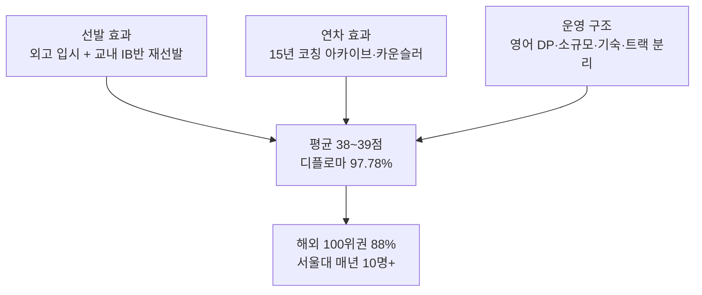

**상담 시 주의 — 경기외고 실적을 일반화하면 안 되는 이유**

| 비교 | 경기외고 | 표선고 (공립 일반고, 전교생 이수) |
|------|---------|-------------------------|
| 모집단 | 외고 + 교내 재선발된 상위 집단 | 도내 일반고 지원자 전체 (학력 편차 큼) |
| 수업 언어 | 영어 DP | 한국어 DP |
| 연차 | 15년차 | 5년차 (1기 졸업 2024) |
| 외부평가 응시 | IB반 거의 전원 | 학년 약 100명 중 26명 응시 (1기) |
| 평균 점수 | 38~39점대 | 29점 (세계 평균 수준) |
| 주력 진로 | 해외 명문대 + 국내 상위권 | **국내 학종 (수능 최저 없음)** + 일부 해외대 |

> **결론:** 경기외고는 "IB 연차가 쌓이면 어디까지 갈 수 있는가"의 **상한선**을 보여주는 학교이고, 표선고는 "선발 없이 일반 공립고 전체에 IB를 적용해도 국내 최상위 대학 진학이 가능한가"를 증명한 **하한선의 돌파** 사례입니다. 두 학교를 함께 보여주면 학부모가 IB를 현실적으로 이해합니다.

---

#### 죽산고등학교

| 항목 | 내용 |
|------|------|
| **홈페이지** | [juksan-mh.goean.kr](https://juksan-mh.goean.kr) |
| **위치** | 경기도 안성시 |
| **인증** | 인증학교 (2025.01) — **경기 공립고 최초 한국어 DP 인증** |
| **학교 유형** | 공립 일반고 (중·고 통합학교) |

**학교 특징:**
- 중학교(MYP)·고등학교(DP) 모두 인증받은 전국 최초 공립 통합학교
- 경기도 안성의 IB 교육 허브 역할
- 논술·서술형 평가 위주, 개인 역량 중심 교육
- 과학/인문 계열 맞춤 과목 선택 (예: IB생명과학+IB영어+IB역사 또는 IB화학+IB언어와문학+IB수학)

**대입 실적:**
- 2028학년도에 첫 DP 졸업생 배출 예정 (현재 재학 중)
- 경기도교육청-서울대학교 업무협약(2024.11) 체결로 IB의 대입 전형 반영 연구 진행 중

---

#### 동탄국제고등학교

| 항목 | 내용 |
|------|------|
| **홈페이지** | [dtg.hs.kr](https://www.dtg.hs.kr) |
| **위치** | 경기도 화성시 동탄 |
| **인증** | 인증학교 (2025.11) |
| **학교 유형** | 공립 국제고등학교 |

**학교 특징:**
- 2024.09 후보학교 → 2025.11 월드스쿨 인증 (약 14개월만에 인증 완료)
- 2026년 16기 학생부터 pre-DP 방식으로 시작, 정식 DP 운영 예정
- 국제고등학교로서 국제 교류·다문화 교육 기반 강점

**대입 실적:**
- DP 졸업생 아직 미배출 (2026년 pre-DP 시작, 2028~2029년 첫 졸업생 예상)

---

#### 군서미래국제학교 (시흥)

| 항목 | 내용 |
|------|------|
| **홈페이지** | [gunseo.goesp.kr](https://gunseo.goesp.kr) |
| **위치** | 경기도 시흥시 |
| **인증** | 인증학교 (2024) — **경기도 공립 최초 IB 인증** |
| **학교 유형** | 공립 초·중·고 통합학교 |

**학교 특징:**
- PYP(초)·MYP(중)·DP(고) 전 과정을 하나의 캠퍼스에서 운영
- 경기도 공립 학교 최초 IB 인증이라는 상징성

---

#### 기타 경기도 신규 인증학교 (2025.11)

| 학교명 | 홈페이지 | 위치 | 특징 |
|--------|---------|------|------|
| 덕정고등학교 | [덕정고](https://school.iamservice.net/organization/18787) | 경기도 양주시 | 2025.11 신규 인증 |
| 관양고등학교 | [gwanyang-h.goeay.kr](https://gwanyang-h.goeay.kr) | 경기도 안양시 동안구 | 2025.11 신규 인증 |
| 남양주다산고등학교 | [nyjdasan-h.goegn.kr](https://nyjdasan-h.goegn.kr) | 경기도 남양주시 | 2020년 개교, 디지털 창의역량 강화 특색 |
| 수원중앙기독고등학교 | [suwoncca-h.goesw.kr](https://suwoncca-h.goesw.kr) | 경기도 수원시 | IB DP 운영 중 |

> 위 학교들은 모두 2025년 신규 인증으로 DP 졸업생은 아직 없음

**경기도 주요 후보/관심 고등학교:**

| 학교명 | 인증 단계 |
|--------|----------|
| 동화고등학교 | 후보/관심학교 |
| 저동고등학교 | 후보/관심학교 |
| 현화고등학교 | 관심학교 |
| 포천고등학교 | 관심학교 |
| 진접고등학교 | 관심학교 |
| 성남외국어고등학교 | 관심학교 |
| 수원고등학교 | 관심학교 |

---

### 3-3. 서울특별시 — 고등학교 22교 운영 (대부분 관심학교 단계)

> 2026년 총 106교 (초 49, 중 35, 고 22). 양천구 10교, 노원구·마포구 각 8교로 최다

| 구분 | 현황 | 비고 |
|------|------|------|
| 인증학교 (DP) | **없음** | 초등 2교만 인증 (구로초, 대왕초 — 2025.12 서울 공립 최초) |
| 후보학교 | 진행 중 | 중학교 중심 (휘경여중, 창덕여중 등) |
| 관심학교 (고등) | 22교 | 2025년부터 고등학교 공모 시작 |

> 서울시교육청은 '한국형 바칼로레아(KB)' 모델을 별도로 구축 추진 중
> 서울 소재 공교육 고등학교 중 DP 인증학교는 아직 없음 — 가장 빨라도 2028년 이후 첫 졸업생 예상

**서울 소재 국제학교 (DP 인증):**

| 학교명 | 홈페이지 | 비고 |
|--------|---------|------|
| Seoul Foreign School (SFS) | [seoulforeign.org](https://www.seoulforeign.org) | IB DP 운영 |
| Dwight School Seoul | [dwight.or.kr](https://dwight.or.kr) | IB DP 운영 |
| Dulwich College Seoul | [seoul.dulwich.org](https://seoul.dulwich.org) | IB DP 운영 |

---

### 3-4. 제주특별자치도

#### 표선고등학교 — 케이스 스터디: "수능 없이 서울대에 간 농어촌 공립고"

| 항목 | 내용 |
|------|------|
| **홈페이지** | [pyoseon.jje.hs.kr](https://pyoseon.jje.hs.kr) |
| **위치** | 서귀포시 표선면 (농어촌 읍면 지역) |
| **인증** | IB DP 월드스쿨 (2021.11) — **전국 최초 학교 단위(Whole-School) IB DP**, 제주 유일 공교육 DP 고등학교 |
| **학교 유형** | 공립 일반고, 남녀공학, 기숙사 운영 |
| **수업 언어** | **한국어 DP** (Group 2 언어 습득 과목 등은 영어) |
| **학비** | 0원 (고교 무상교육 + IB 운영비·IBO 비용은 제주도교육청 부담). 급식·기숙사비 등 수익자부담경비만 발생 |
| **학년 규모** | 약 100~150명 |

##### ① 왜 표선고였나 — 도입 배경과 경과

농어촌 지역 공립 일반고로, 성적 상위권 학생이 제주시·도외로 빠져나가며 학교 경쟁력이 약해지던 상황이었습니다. 학교는 **"평가 방식을 바꾸지 않으면 수업이 바뀌지 않는다"** 는 문제의식에서 IB를 탐색했습니다.

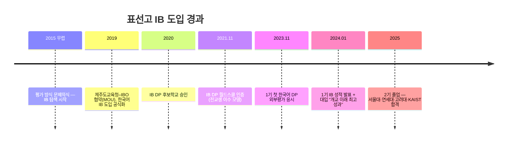

##### ② 입학 전형 — "IB 학교인데 입학 시험이 없다"

| 항목 | 내용 (2026학년도 신입생 기준) |
|------|------|
| 모집 범위 | **제주 도내** 중학교 졸업(예정)자 + 도내 거주자 (제주혁신도시 이전기관 종사자 자녀·제주영어교육도시 국제학교 중학과정 이수자는 예외 지원 가능) |
| 원서 접수 | 2025.12.11 ~ 12.15 (특례입학 별도 12.1 ~ 12.5) |
| 전형 방법 | **중학교 내신 개인석차백분율 100%** — 면접·자기소개서 없음, 남녀 구분 없이 선발 |
| 동점자 사정 | ① 출결 → ② 봉사활동 → ③ 교과 성적 |
| 합격 발표 | 2025.12.19, 등록 12.22 ~ 12.23 |
| 경쟁률 | 약 1.39:1 (2025학년도) — IB 도입 후 상승 추세 |
| 유의 사항 | "한국어 IB 교육프로그램 운영 학교"임을 인지하고 지원 |

> 타시도 학생은 원칙적으로 지원할 수 없으므로, 도외 가정은 **거주 요건(이주 시점)** 을 먼저 확인해야 합니다. 1기 졸업생 기준 출신 지역은 표선 42.6% · 제주 타 지역 27.8% · **타시도 29.6%** 로, IB를 위해 제주로 이주한 가정이 상당수입니다.

##### ③ 수업 방식 — 3축 체제

수능 문제풀이식 수업을 **완전히 배제**하고, 학교 전체가 탐구·논술·서술·구술 중심으로 운영됩니다.

| 축 | 내용 |
|----|------|
| **1축 · IB DP 정규 수업** | 6과목(HL 3 + SL 3) — 모든 과목이 토론·탐구·서술 평가. 고1은 Pre-DP(탐구 기초·글쓰기 적응), 고2~3이 정식 DP 2년 |
| **2축 · IA·EE 개별 탐구** | 과목별 IA + EE 4,000단어 소논문 — **지도교사 1:1 매칭**. 고1에 주제 탐색, 고2부터 본격 집필 |
| **3축 · CAS 협업 프로젝트** | 1개월 이상 팀 프로젝트 — 표선면 지역사회·공동체 연계 봉사·탐구 |

**재학생 하루 일과 (예시)**

| 시간 | 활동 |
|------|------|
| 08:30–12:30 | IB DP 정규 수업 (논·서술 중심) |
| 12:30–13:30 | 점심 + 친구들과 IA·EE 진행 상황 공유 |
| 13:30–16:30 | 오후 수업 (TOK·과학 실험·HL 심화) |
| 16:30–18:00 | CAS 프로젝트·동아리·운동 |
| 19:00–22:00 | 기숙사 자율학습 — IA 작성·EE 자료조사·에세이 |

> 주변에 학원이 거의 없어 **사교육 의존도가 매우 낮습니다.** 학습의 절반은 교내 자율학습과 교사 피드백으로 이뤄집니다.

##### ④ "수능 없이" 대학에 간 경로

표선고 학생들은 **수능 최저학력기준이 없는 학생부종합전형(학종)** 을 주력으로 대학에 진학했습니다. IB 수업에는 수능 문제풀이 시간이 없기 때문에, 처음부터 정시·수능최저 전형이 아니라 **학생부(내신 + 세특)** 로 승부하는 구조입니다.

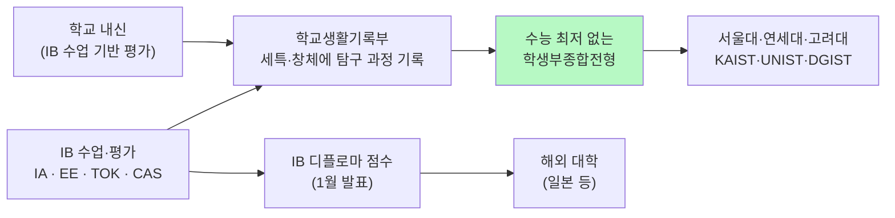

| 단계 | 핵심 |
|------|------|
| 국내 수시 원서 (9월) | IB 점수는 아직 없음 → **학생부만으로 평가**. IB 점수(45점)는 국내 대입 전형자료가 아님 |
| 학생부의 강점 | EE·IA·TOK 탐구가 세특에 "질문 → 방법 → 한계 → 수정"의 과정으로 기록됨 |
| 면접 | 4,000단어 논문을 직접 쓴 경험 → "왜 그 주제를, 어떤 방법으로, 한계는?"에 자기 언어로 답변 |
| 추가 무기 | 농어촌 지역 거주 요건을 충족하면 **농어촌 특별전형** 지원 가능 |
| 해외대 | IB 디플로마 점수로 직접 지원 (1기: 일본 도쿄농업대·소카대 합격) |

> ⚠️ IB 성적을 대입 전형자료로 쓸 수 있게 하는 고등교육법 개정안이 2023년 발의됐지만 시행은 확인되지 않았습니다. 2026년 현재 국내 대학에 **"IB 전형"은 따로 없으며**, IB 학생도 학생부로 똑같이 평가받습니다.

##### ⑤ 대입 실적

| 구분 | 2024학년도 대입 (1기) | 2025학년도 대입 (2기) |
|------|---------------------|----------------|
| DP 외부평가 응시 | 26명 → **26명 전원** 디플로마(11명) 또는 과목이수증(15명) 취득 | - |
| 평균 점수 | 29점 (같은 시기 세계 평균 29.06점과 동일 수준), 30점 이상 5명 | - |
| 서울대 | **1명** | **1명** |
| 연세대/고려대 | 각 1명 | 연세대 2명, 고려대 2명 |
| KAIST | KAIST 합격 보도 있음 | **1명** |
| UNIST/DGIST | 각 2명 | - |
| 성균관대 · 중앙대 · 경희대 | 각 2명 | - |
| 이화여대 | 1명 | - |
| 수도권 주요 대학 합계 | 약 30명 (수시) | - |
| 제주대 | 18명 | - |
| 해외 | 도쿄농업대·소카대 | - |

**IB 도입 전후 변화**

| 지표 | IB 도입 전 | IB 1기 졸업 (2024학년도) |
|------|---------|------------------|
| 도외 4년제 대학 합격 (건) | 108 (2023학년도) | **189** (+75%) |
| 4년제 대학 진학률 | 약 60~70% | **75.6%** |
| 신입생 경쟁률 | — | 약 1.39:1 (2025학년도), 상승 추세 |

##### ⑥ 반드시 함께 알려야 할 한계 (균형 상담)

| 쟁점 | 내용 |
|------|------|
| **외부평가 응시율** | 1기 졸업생 105명 중 99명이 IB DP 과정에 참여했지만 **외부평가 응시는 26명**. 전교생이 IB 수업을 듣지만 모두가 디플로마에 도전하는 것은 아님 |
| **학력 격차** | IB 명성으로 중상위권 학생이 유입되며 **상·하위권 편차가 커짐** (제주일보 지적). 지역 학생의 영어 과목 적응 부담도 보고됨 |
| **정시 불리** | 수능 문제풀이를 하지 않으므로 의대·서울대 정시 등 **수능 올인 전략과는 충돌** |
| **도내 모집 제한** | 타시도 학생은 이주가 필요 |
| **명문고화** | 모집단 수준이 올라가며 "농어촌 학교의 가성비" 효과는 점차 줄어드는 중 |

##### ⑦ 표선고에 맞는 학생 / 다시 생각해 볼 학생

| ✅ 잘 맞는 학생 | ⚠️ 다시 생각해 볼 학생 |
|---------------|-------------------|
| 학원 없이 스스로 공부를 설계하는 자기주도형 | 수능 정시 최상위(의대·서울대 정시)가 1순위 |
| 시험보다 에세이·탐구·토론이 재미있는 학생 | 긴 글쓰기에 강한 거부감이 있는 학생 |
| 사교육비 없이 IB를 원하는 가정 | 또래 경쟁·학원 인프라가 있어야 공부가 되는 학생 |
| 학종(+농어촌 전형)으로 대입을 설계하려는 학생 | 제주 이주가 어려운 도외 가정 |

**중학생 준비 로드맵 (표선고 지망)**

| 시기 | 할 일 |
|------|------|
| 중1 | 월 1권 이상 교양서 읽고 "내 생각" 쓰기, 관심 탐구 주제 메모, 자기주도 학습 습관 |
| 중2 | 한 주제로 1,000~2,000자 논증 글쓰기, 협업·봉사 경험(CAS 대비), 표선고 설명회 참가 |
| 중3 | **전 과목 내신 관리** (내신 100% 선발), 구술 발표·토론 경험, HL/SL 과목 구조 미리 이해, 이주 가정은 거주 요건 점검 |

---

**제주 소재 국제학교 (DP 인증):**

| 학교명 | 홈페이지 | 비고 |
|--------|---------|------|
| Branksome Hall Asia (BHA) | [branksome.asia](https://www.branksome.asia) | IB DP 운영 |
| North London Collegiate School Jeju (NLCS) | [nlcsjeju.kr](https://www.nlcsjeju.kr) | IB DP 운영 |

---

### 3-5. 전북특별자치도

#### 지평선고등학교

| 항목 | 내용 |
|------|------|
| **홈페이지** | [school.jbedu.kr/jipyeongseon-h](https://school.jbedu.kr/jipyeongseon-h) |
| **위치** | 전북 김제시 성덕면 |
| **인증** | 인증학교 (2026.06) — **전북 최초 IB DP 월드스쿨** |
| **학교 유형** | 대안교육 특성화고등학교 (원불교 운영) |

**학교 특징:**
- 대안교육 특성화고로서 IB를 도입한 독특한 사례
- 도서관 중심 독서·토론, 인문학 탐구, 생태적 감수성 교육을 IB DP와 결합
- "지평선을 넘어, 새로운 배움" 비전
- 소규모 학교의 장점을 살린 개별화 교육

**대입 실적:**
- 2026.06 인증으로 DP 졸업생 아직 미배출

**기타 전북 IB 관심학교:**

| 학교명 | 인증 단계 |
|--------|----------|
| 자유고등학교 | 관심학교 |
| 전주중앙여자고등학교 | 관심학교 |
| 순창고등학교 | 관심학교 |

---

### 3-6. 충청북도

#### 단재고등학교

| 항목 | 내용 |
|------|------|
| **홈페이지** | [school.cbe.go.kr/danjae-h](https://school.cbe.go.kr/danjae-h) |
| **위치** | 충북 청주시 |
| **인증** | 인증학교 (2025.12) — **충북 최초 IB DP 월드스쿨** (후보 승인 후 10개월만에 인증) |
| **학교 유형** | 공립 일반고 |

**학교 특징:**
- 학년당 1학급 소규모 체제 — 학생 한 명 한 명 세밀한 성장 관리
- '정답 중심'이 아닌 **'질문 중심'** 수업이 핵심
- 학생 주도성을 수업·프로젝트·학교생활 전반에 걸쳐 중시

**대입 실적:**
- 인증 직후로 DP 졸업생 아직 미배출

---

### 3-7. 충청남도

#### 충남삼성고등학교

| 항목 | 내용 |
|------|------|
| **홈페이지** | [cnsa.hs.kr](https://www.cnsa.hs.kr) |
| **위치** | 충남 아산시 |
| **인증** | 인증학교 (2020.08) — **영어 운영** |
| **학교 유형** | 사립 자율형사립고 (광역자사고) |

**학교 특징:**
- '학생 선택 진로별 교육과정' — 3계열 13과정의 맞춤형 교육
- 2020년 IB DP 도입, 영어로 운영
- 전국 7개 비서울 광역자사고 중 서울대 합격 실적 최상위권

**대입 실적:**

| 구분 | 내용 |
|------|------|
| 서울대 합격 추이 | 2022대입 16명(수시13+정시3), 2023대입 15명 |
| 최근 5년 서울대 수시 | 44명 (7개 비서울 광역자사고 중 2위) |
| 진학 특징 | 국내 상위권 대학 + IB 점수 활용 해외 대학 동시 지원 |

---

### 3-8. 대전광역시 (후보학교 단계)

| 학교명 | 홈페이지 | 인증 단계 | 비고 |
|--------|---------|----------|------|
| 대전대성고등학교 | - | **후보학교** | 2025.11 후보 승인 |
| 서대전고등학교 | - | **후보학교** | 2026.04 후보 승인 |
| 서일고등학교 | - | **후보학교** | 2026.05 후보 승인 |

---

### 3-9. 부산·인천·기타

| 지역 | 학교명 | 홈페이지 | 인증 단계 | 비고 |
|------|--------|---------|----------|------|
| 부산 | (공교육 DP 없음) | - | - | 2025년 IB 연구학교 시작, 2028년 이후 정착 목표 |
| 부산 | International School of Busan | [isbusan.org](https://www.isbusan.org) | 인증학교 (국제학교) | |
| 인천 | Chadwick International (송도) | [chadwickinternational.org](https://www.chadwickinternational.org) | 인증학교 (국제학교) | DP, CP 포함 |
| 경남 | Gyeongnam International Foreign School | - | 인증학교 (국제학교) | 사천 |
| 광주 | (공교육 DP 없음) | - | 탐색학교 단계 | |
| 강원 | (공교육 DP 없음) | - | IB 도입 추진 중 | |

---

## 4. IB 도입 타임라인

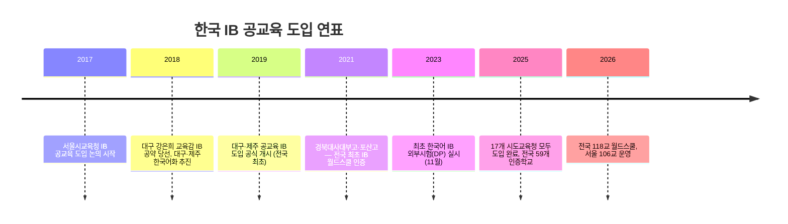

---

## 5. IB DP 실전 준비 로드맵

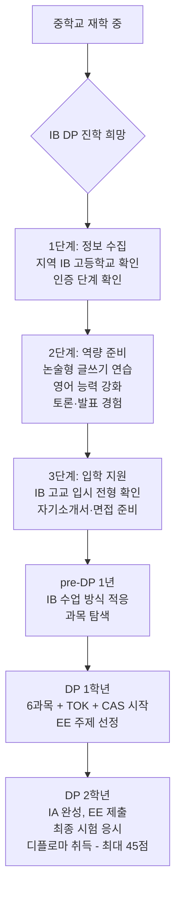

---

## Sources

**2026.10 업데이트 추가 출처 (수업 방식·초중고 대표학교·표선고·경기외고)**

- [ReadingClue — IB 인증학교 유형 개요](https://www.readingclue.com/career?tab=admission&category=ib)
- [ReadingClue — 제주 표선고 상세 (입학 전형·로드맵)](https://www.readingclue.com/career?tab=admission&category=ib&school=jeju_pyoseon_ib)
- [한국교육신문 — 경북대사대부고 IB 수업 (미적분 밈·TOK 지도 토론)](https://www.hangyo.com/mobile/article.html?no=103245)
- [교육을 비추다 — IB 확산의 모델 구축: 제주 표선고 사례](https://www.kyobit.com/news/articleView.html?idxno=2291)
- [서울신문 — '변방의 공립고' 표선고의 반란](https://m.seoul.co.kr/news/2024/01/10/20240110500048)
- [제주의소리 — 첫 IB 졸업생 배출한 표선고 대입 성과](https://www.jejusori.net/news/articleView.html?idxno=422719)
- [한국경제 — 표선고 IB 이수학생 첫 배출](https://www.hankyung.com/article/202401092217Y)
- [제주일보 — IB 월드스쿨 표선고, 학생 간 학력 격차 커](https://www.jejunews.com/news/articleView.html?idxno=2209267)
- [제주의소리 — 제주북초 IB 월드스쿨 (제주 PYP·MYP 현황)](https://www.jejusori.net/news/articleView.html?idxno=421414)
- [한국강사신문 — 서울시교육청 1호 IB 월드스쿨 (구로초)](https://www.lecturernews.com/news/articleView.html?idxno=191620)
- [한국교육신문 — 국내 사립 중 최초 IB 월드스쿨 대구중앙중](https://hangyo.com/mobile/article.html?no=95921)
- [호남교육신문 — 나주금천중 광주·전남 최초 MYP 인증](https://www.ihopenews.com/news/articleView.html?idxno=250113)
- [베리타스알파 — 2026추천고교 경기외고](https://www.veritas-a.com/news/articleView.html?idxno=579252)
- [베리타스알파 — 경기외고 IB졸업생 해외실적 (2018)](https://www.veritas-a.com/news/articleView.html?idxno=119962)
- [교육을 비추다 — 경기외고 IB·국내 과정 이원화 운영](https://www.kyobit.com/news/articleView.html?idxno=2561)

**기존 출처**

- [교육을 비추다 — IB 도입 7년차 현황](https://www.kyobit.com/news/articleView.html?idxno=3142)
- [대구시교육청 IB 프로그램 운영 현황](http://www.dge.go.kr/main/cm/cntnts/cntntsView.do?mi=5768&cntntsId=3407)
- [경기도교육청 IB 월드스쿨 21교 인증 완료](https://www.gninews.co.kr/news/article.html?no=748975)
- [서울시교육청 IB 학교 현황](https://www.sen.go.kr/www/eduinfo/ib/ib_3.jsp)
- [서울 공립학교 최초 IB 인증학교 — 전국 59개](https://v.daum.net/v/20251219125123423?f=p)
- [대구 중앙고 IB DP 월드스쿨 인증](https://www.imaeil.com/page/view/2025121519100109569)
- [경북대사대부고·포산고 IB 인증](http://www.veritas-a.com/news/articleView.html?idxno=391338)
- [전북 지평선고 IB DP 인증](https://www.newsis.com/view/NISX20260630_0003689302)
- [충북 단재고 IB 월드스쿨 인증](https://v.daum.net/v/qSfD4KXSEG?f=p)
- [대전교육청 IB 후보학교](https://www.goodmorningcc.com/news/articleView.html?idxno=446314)
- [군서미래국제학교 IB 인증](https://www.kyeonggi.com/article/20241113580061)
- [IBO 공식 — 한국 학교 리소스](https://ibo.org/about-the-ib/the-ib-by-region/ib-asia-pacific/resources-for-schools-in-south-korea/)
- [한국 IB 학교 지도](https://korea-ib-school-map-hosting.vercel.app/)
- [한국 IB 교육과정 2025 최신 — IBMaster](https://www.ibmaster.net/blog/IB-in-Korea)
